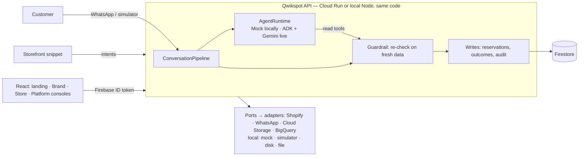

# Qwikspot

**AI that turns a shopper's "I need it today" into a sale at the nearest store that really has it — and shows the brand what happened.**

Qwikspot is an omnichannel commerce layer for D2C brands. It watches storefront intent (a product view, an abandoned cart, a "Need it today?" tap), continues the journey in a WhatsApp conversation, lets an AI agent pick the next best action from **verified** catalogue and store-stock data, reserves the product at an eligible nearby store, guides the store through the pickup, and records the outcome — online or in store — so the brand can see whether a weekday problem is demand or availability.

Every AI action is re-checked by a guardrail on fresh data before anything is written; the agent can never invent stock, choose a closed store or touch another customer's data.

## Try the live demo (judges start here)

**Live app:** <https://qwikspot.web.app> · **API on Cloud Run:** <https://qwikspot-api-4rscricz3q-el.a.run.app/api/health>

Everything below runs on Google Cloud with the real integrations: **Gemini on Vertex AI** answers shoppers and the console analysts, the shopper chats on a real **WhatsApp Business** number, and the products come from the brand's real **Shopify** store (AquaSkin). No install, no account: the login page has one-click demo logins.

| You need | |
|---|---|
| A computer with a browser | for the three consoles |
| A phone with WhatsApp | for the shopper side (scan a QR) |
| The AquaSkin store password | **`aquaskin`** (it is a Shopify development store, so Shopify asks for it once) |

**Demo logins** (on <https://qwikspot.web.app/login>, under **Try the demo**: click a tile, then **Sign in**):

| Tile | Console | Use it for |
|---|---|---|
| **Brand Admin — AquaSkin** | Brand Console | Start here |
| **Wellness Mart, Satellite** | Store Console | The store the demo hold goes to |
| **Platform Admin** | Platform Console | The Qwikspot team's view |

Each browser tab keeps its own sign-in, so you can open the three consoles in three tabs (or windows) side by side.

### The live demo, step by step (about 10 minutes)

| # | Where | Do | You should see |
|---|---|---|---|
| 0 | **Brand Console → Overview** | *(Optional)* **Demo guide → Reset demo**. It asks first, and resets the shared demo for every judge. | A clean demo with four weeks of flagged synthetic history. The **Try the live demo** checklist (bottom right) ticks each step below as you do it. |
| 1 | Brand Console header | **Open AquaSkin store** (or scan its QR with your phone). Enter the store password. | The brand's real Shopify store. |
| 2 | The store | Open **Vitamin C Glow Serum** → pick **30 ml** → **Need it today? Ask on WhatsApp**. On a computer, **scan the QR** under the button with your phone. | WhatsApp opens on your phone with the message ready. Send it. |
| 3 | WhatsApp | When asked where you are, reply **Satellite** (or **Navrangpura**). | Gemini lists the stores that have it **in stock now**, nearest first, next to home delivery. |
| 4 | WhatsApp | Tap **Pick up: Wellness**. | **On hold for you**: the store, its location and a **6-digit pickup code**. |
| 5 | New tab: **Store login → Wellness Mart, Satellite** | **Today**: the new hold arrives. **Confirm → Mark ready → Customer arrived → Complete** (type the pickup code from WhatsApp). | Each step arrives in your WhatsApp; Complete sends one thank-you. The store never sees your phone number. |
| 6 | **Brand Console → Conversations** | Open your conversation. | The **journey** (website → chat → hold → pickup), and **Why Qwikspot did this**: a plain reason and a safety check for each AI step, labelled **Gemini (Vertex AI)**. |
| 7 | **Ask Qwikspot** (top of any console) | Ask *"How did we do this week?"* | An **AI summary** from the brand's own data, with links to where each part comes from. |
| 8 | Brand → **Insights** and **Sales** | — | The funnel, the weekday demand-vs-stock reading and restock suggestions; walk-in sales beside Qwikspot pickups. |
| 9 | Store → **Sales**, then **Stock** | Record a walk-in sale (add a product → Cash → **Record sale**). | A receipt; on Stock the product's row says *Last change: In-store sale*. The AI now offers one unit fewer. |
| 10 | New tab: **Platform login** | Overview → Brands → Retail network → Audit → System | Every brand's health and onboarding as totals, the audit log, and the live system: Cloud Run + Firestore, Gemini, WhatsApp, Shopify. **It never shows a customer.** |

**The automatic follow-up (optional, about 5 minutes).** In the **same browser** where you tapped *Need it today?* in step 2 (that is how Qwikspot knows you, with your consent), open the store in a **new tab**, add a product to the cart and close the tab without messaging. About 2–7 minutes later one WhatsApp follow-up arrives; in **Brand → Conversations** you can press **Process due work now** after about 2 minutes to send it at once. **Conversations → Intents** shows every website session and, for any that was not followed up, the reason (for example *already in a conversation* or *one follow-up per customer per day*).

**Good to know**
- The AI is **Gemini**: most replies take 3–7 seconds, and now and then up to about 20 seconds. If Gemini ever fails, a rule-based backup answers, and the decision card says so.
- **Reset demo** is shared: it clears every judge's chats and holds. Use it at the start, not in the middle of someone else's test.
- Only the stores in **Satellite** and **Navrangpura** (Ahmedabad) are in the demo network.
- The longer manual test, with privacy and refusal stories, is in [docs/JUDGE_TEST_PLAN.md](docs/JUDGE_TEST_PLAN.md).

## Run it locally (synthetic data, no Google Cloud)

Requires **Node.js 24** and **Java 21+** (Firebase emulators). No Google Cloud account is needed: locally the AI is a deterministic mock, WhatsApp is a simulator and the catalogue is mocked.

```bash
npm install
cp backend/.env.example backend/.env   # turns on DEMO_MODE: demo logins on the login page + Reset demo
npm run emulators            # terminal 1: Auth + Firestore emulators
npm run seed:demo            # terminal 2: demo brand, stores, stock, users, 4 weeks of synthetic history
npm run dev:backend          # terminal 2: API on :8080
npm run dev:frontend         # terminal 3: http://localhost:5173
```

Open <http://localhost:5173> and use the **Try the demo** tiles on the login page (local password `qwikspot-demo-1`, emulators only). `npm run demo:check` walks the core journey over HTTP and prints ✔ / ✘ per step (`BASE_URL` points it at a deployment). Emulator data persists between runs in `.emulator-data/` (git-ignored); delete the folder to start from nothing.

## Connect a real Shopify store (local)

Optional — everything above works on the mock catalogue. This connects a brand to a real Shopify store (here the dev store **AquaSkin**, `m6ccxz-wk.myshopify.com`) through the Shopify app **Qwikspot** in the Dev Dashboard (scopes `read_products, read_inventory, read_customers, read_orders`).

1. **Start a tunnel to the backend.** In VS Code: **Ports** panel → **Forward a Port** → `8080` → right-click → **Port Visibility → Public**. Copy its `https://…devtunnels.ms` address (no trailing slash). Shopify must reach it for the OAuth callback and the webhooks.
2. **Point the Shopify app at it.** Dev Dashboard → Qwikspot → **Versions/Configuration**: set the redirect URL to `<tunnel>/api/integrations/shopify/callback`, then release the version.
3. **Add to `backend/.env`** (never commit it):
   ```bash
   COMMERCE_PROVIDER=shopify
   SHOPIFY_API_KEY=<the app's Client ID>
   SHOPIFY_API_SECRET=<the app's Client secret>
   PUBLIC_BACKEND_URL=https://<your-tunnel>.devtunnels.ms
   FRONTEND_URL=http://localhost:5173
   TOKEN_ENCRYPTION_KEY=<node -e "console.log(require('crypto').randomBytes(32).toString('base64'))">
   ```
   `SHOPIFY_API_VERSION` defaults to `2026-10` and `SHOPIFY_SCOPES` to the four scopes above. The backend refuses to start with a missing or invalid value and names it (never its value).
4. **Start** the emulators, the backend and the frontend as above. Seed first if you have not: `npm run seed:demo` syncs every brand's catalogue, so run it once **before** setting `COMMERCE_PROVIDER=shopify` (or with `COMMERCE_PROVIDER=mock npm run seed:demo`). The emulator data then persists.
5. **Connect.** Brand login → **Settings** → **Shopify** → enter `m6ccxz-wk.myshopify.com` → **Connect Shopify** → approve in Shopify. You land back on Settings with "Shopify connected"; Qwikspot stored the store's token encrypted on the server and registered its webhooks (`orders/create`, `orders/cancelled`, `products/create|update|delete`, `app/uninstalled`).
6. **Sync.** **Sync products**: the catalogue now comes from the store (its products replace the seeded mock catalogue, which is archived). The same click registers any webhook a store connected by an earlier version lacks and checks the last 7 days of orders for any the webhooks missed. From then on, product changes in Shopify re-sync the catalogue by themselves.
7. **Map the stock.** Brand → Overview → Demo guide → **Reset demo**. It keeps the Shopify connection, syncs from Shopify and re-imports the demo stores' stock, so every SKU — including the store's six new ones (micellar water, eye cream, lip balm, body lotion) — maps to the live products.

A chat's "Buy online" link opens the store's cart with the product in it and carries `qs_ref` as a cart attribute (`attributes[qs_ref]`), so the order Shopify creates is attributed to that conversation; other orders are recorded unattributed. "Buy online" is only offered while Shopify says the variant can be bought online. A cancelled order's sale is taken back out of the insights. `POST /api/integrations/shopify/orders/sync` runs the missed-order check on demand. **Disconnect** (or uninstalling the app in Shopify) deletes the stored token.

## How it is built



- **Ports and adapters:** the core never imports an adapter (tested); the `local` and `gcp` profiles differ only in which adapters `composition/container.ts` wires. The `gcp` profile refuses every mock/local adapter and checks all required settings at startup.
- **Multi-tenant by construction:** scope comes only from the verified token and the user record — never from a client-supplied `brand_id`. Retail Admins see exactly one store.
- **One stock for the store and the AI (Change 19):** a store records each walk-in sale in the Store Console (Sales); the units leave its stock in the same transaction, so the agent never offers what was just sold, and the stock row says why it changed. The Brand Console's Sales tab shows those sales beside Qwikspot pickups.
- **Safety:** the agent's writes run only after the guardrail; reservations change stock in one transaction; every mutating route is audited; logs carry IDs, never PII or message text.

The deployed app (qwikspot.web.app) runs the `gcp` profile: Gemini on Vertex AI, the brand's WhatsApp Business number and its Shopify store. Locally everything runs on the Firebase emulators with a mock catalogue, a WhatsApp simulator (it renders only what WhatsApp can) and a deterministic mock agent (labelled "Mock AI · deterministic"), so the same code can be tested without any account.

## Checks

```bash
npm run format:check && npm run typecheck && npm test   # unit + contract tests (backend + frontend)
npm run test:emulator                                    # end-to-end on the emulators (full journey, Reset demo, races)
npm run build && npm run secrets:scan                    # no secrets in the repo or the built bundle
npm run demo:check                                       # smoke-walk a running stack
```

## Repository and docs

```text
frontend/        React + TypeScript + Vite — landing, login, Brand · Store · Platform consoles
backend/         Node.js 24 + TypeScript + Express — domain / application / ports / adapters
infrastructure/  Firestore rules and indexes, Cloud Build, deploy scripts
docs/            The specification (00–11), the deployment runbook (12) and the screenshot set (docs/screenshots)
```

- What each surface shows, and its states: [docs/11_INTERFACE_CONTRACT.md](docs/11_INTERFACE_CONTRACT.md)
- Screenshots of the judge script (desktop and phone): [docs/screenshots/](docs/screenshots/README.md)
- Architecture, scaling and roadmap: [docs/03_TECH_ARCHITECTURE.md](docs/03_TECH_ARCHITECTURE.md)
- Deploying to Google Cloud: [docs/12_DEPLOYMENT_RUNBOOK.md](docs/12_DEPLOYMENT_RUNBOOK.md) and [infrastructure/README.md](infrastructure/README.md)
- Milestones and what each one taught: [docs/10_EXECUTION_PLAN.md](docs/10_EXECUTION_PLAN.md), [docs/09_LEARNING_LOG.md](docs/09_LEARNING_LOG.md)

Status: live on Google Cloud (Cloud Run + Firestore + Vertex AI) with the real Shopify and WhatsApp integrations; 1,400+ automated tests and the Firestore emulator suite pass.

## Core loop

Digital intent → Context → AI decision → Conversational action → Online / retail purchase → Outcome → Brand intelligence

Built with React, TypeScript, Node.js, Firebase Auth, Firestore, Cloud Run, Google ADK, Gemini on Vertex AI, BigQuery (Looker optional).
